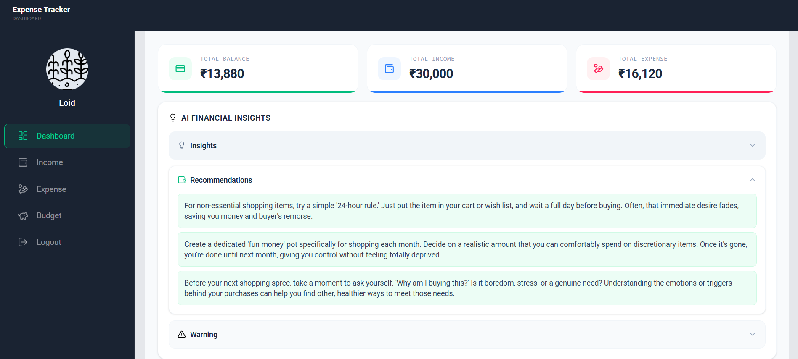
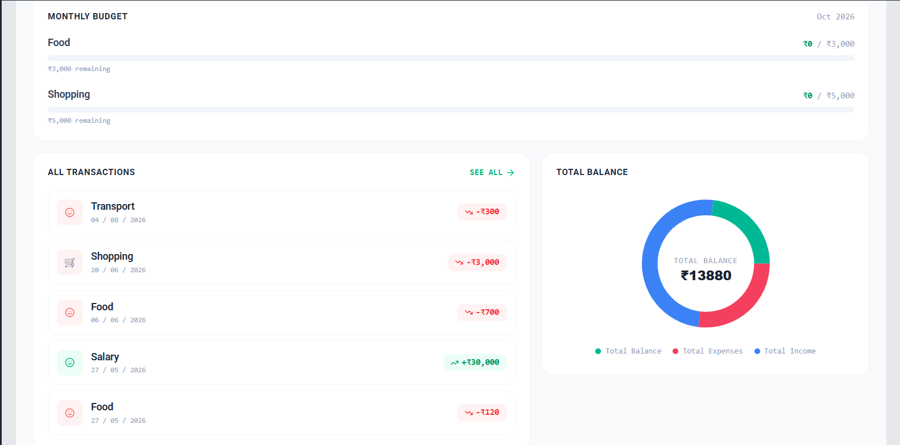
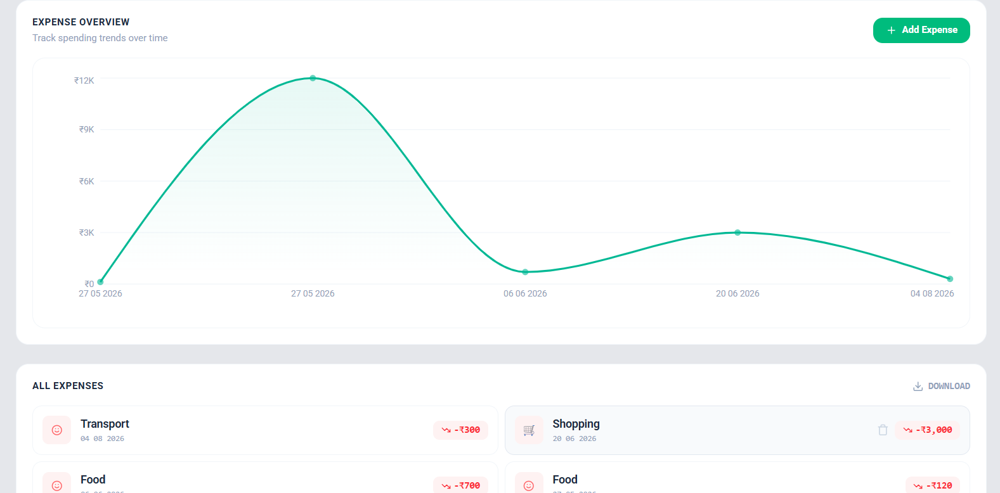
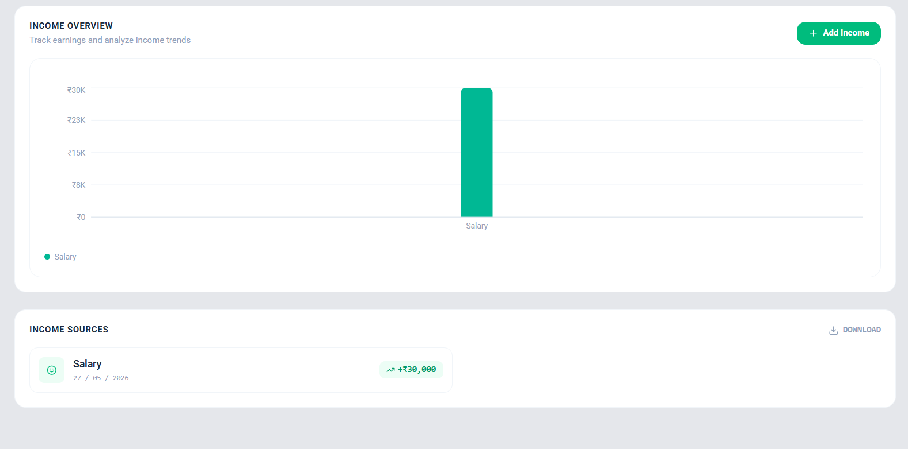
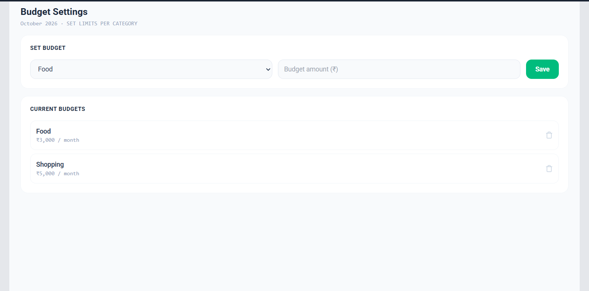

#  Expense Tracker

> A full-stack expense management application for tracking income and expenses, managing monthly category budgets, visualizing financial data, and receiving AI-powered spending insights.

🔗 **Live Demo:** https://expense-tracker-smoky-zeta-48.vercel.app

##  Screenshots

### Dashboard




### Expense Management



### Income Management



### Budget & Analytics



##  Features

###  User Authentication

* User signup and login
* Profile image upload during signup
* Profile images stored using Cloudinary
* User-specific financial data

###  Financial Dashboard

* Overview of total balance, income, and expenses
* Monthly budget summary
* Recent transactions
* Visual breakdown of current balance using a doughnut chart

###  Expense Management

* Add and manage expenses
* View expense-related financial information
* Visualize expense data through charts

###  Income Management

* Add and manage income
* View income-related financial information
* Visualize income data through charts

###  Monthly Budgets

* Set monthly budgets according to spending categories
* Track category-wise budget allocation

###  AI-Powered Insights

* Analyze expense details using Google Gemini
* Generate personalized spending insights
* Receive recommendations for improving spending habits

###  Excel Export

* Export financial data to an Excel file for offline analysis and record keeping

##  Tech Stack

**Frontend**

* React
* Tailwind CSS
* Recharts

**Backend**

* Node.js
* Express.js

**Database**

* MongoDB

**Authentication**

* JWT

**AI**

* Google Gemini

**File Storage**

* Cloudinary

**Other**

* Multer
* Excel export
* REST APIs

##  Application Flow

```text
User
 │
 ├── Signup / Login
 │       │
 │       └── Profile Image → Cloudinary
 │
 ▼
Dashboard
 │
 ├── Balance / Income / Expense Summary
 ├── Monthly Budget Summary
 ├── Recent Transactions
 ├── Balance Visualization
 └── AI Insights
          │
          └── Expense Data → Gemini
                              │
                              ▼
                       Insights & Recommendations
 │
 ├── Add Income
 ├── Add Expense
 ├── Manage Category Budgets
 └── Export Financial Data → Excel
```

##  Project Structure

```text
expense-tracker/
│
├── backend/
│   └── ...
│
├── frontend/
│   └── expense-tracker/
│       ├── public/
│       ├── src/
│       ├── package.json
│       └── ...
│
├── screenshots/
└── README.md

##  Getting Started

### 1. Clone the repository

```bash
git clone https://github.com/Saanvi8888/expense-tracker.git
cd expense-tracker
```

### 2. Install dependencies

Install the dependencies for both the frontend and backend:

```bash
cd frontend/expense-tracker
npm install
```

```bash
cd ../backend
npm install
```

### 3. Configure environment variables

Create the required `.env` files for the frontend and backend.

Add your MongoDB, JWT, Cloudinary, Gemini, and other required configuration values.

> Keep your `.env` files private and never commit API keys or credentials to GitHub.

### 4. Run the application

Start the backend and frontend development servers separately.

```bash
npm run dev
```


